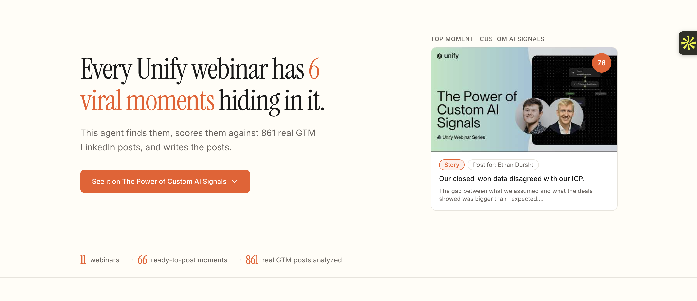
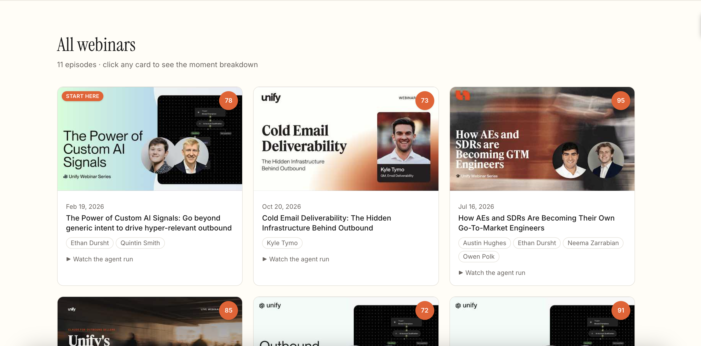
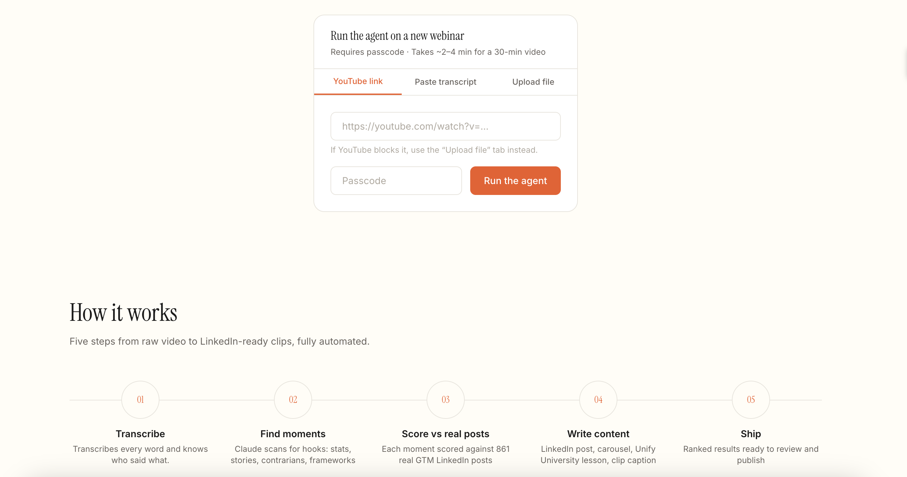
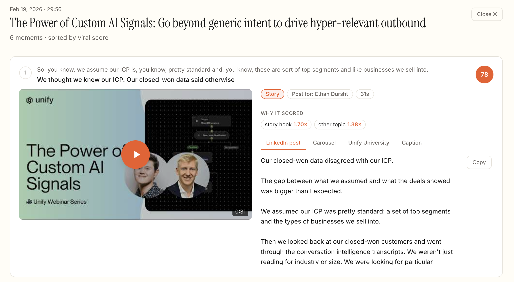

# Replay Engine

**An end-to-end AI agent that turns any GTM webinar into ranked, ready-to-post LinkedIn content, scored against 861 real GTM LinkedIn posts.**

Built for **Unify** ($40M Series B, backed by the OpenAI Startup Fund).

**[Live demo](https://replay-engine-eta.vercel.app)** · **[2-min walkthrough](LOOM_LINK)**

## Results

| Metric | Result |
|---|---|
| Webinars processed | **11** (every Unify webinar) |
| Ready-to-post moments | **66** (each with a LinkedIn post, carousel, Unify University lesson, and clip caption) |
| LinkedIn posts analyzed | **861** across Unify's team and top GTM creators |
| Backtest | **168** real posts; ranking tracks real performance on the CEO's posts (**ρ ≈ 0.5**) |
| Quality audit | **0 critical issues** across **72** generated posts |
| Speed | **48-min video → results in ~5 min**, fully automated |

*11 webinars in the library, each ranked by viral score — click any card to view the full moment breakdown.*

## The problem

Unify's webinars hold the team's best thinking, but the recordings rarely travel beyond the live audience. Meanwhile, LinkedIn is Unify's highest-leverage channel: one seed-round announcement drove ~420 demo requests in 48 hours. The best moments were sitting unused.

## What it does

1. **Takes any input:** YouTube link, uploaded video/audio, or pasted transcript
2. **Transcribes with speaker labels** (AssemblyAI), with an automatic caption fallback (Supadata) when YouTube blocks cloud servers
3. **Identifies every speaker and routes posts correctly:** current team members post in first person; former speakers and guests are credited on the company page
4. **Mines 15–25 standalone 30–90 second moments** with a custom Claude skill, skipping intros, polls, and housekeeping
5. **Scores every moment against a data-backed virality rubric,** re-cuts weak openings to start on the hook, and picks a diverse top 6
6. **Writes the content:** LinkedIn post, carousel outline, Unify University lesson, and on-screen caption
7. **Runs automated quality gates** before anything is shown

*Submit any YouTube link, paste a transcript, or upload a file — results arrive in ~5 min.*

## The data: what actually goes viral in GTM

- **Scraped 861 LinkedIn posts** (Apify) from Unify's team and leading GTM creators
- **Defined "viral" relative to each creator:** an outlier is 3x+ that author's median engagement, which removes big-account bias
- **Tagged every post with Claude** (hook type, topic, specificity, format) and computed lift per feature
- **Key finding:** story hooks earn **1.70x** lift and personal stories **1.74x**, while how-to hooks earn just **0.31x**
- **Why it matters:** Claude's unguided picks skewed toward how-tos. The data re-ranked them, and one trimmed clip jumped from a score of **18 → 73**
- **Backtested on 168 real posts** with engagement hidden: the ranking tracks real performance on the CEO's posts (ρ ≈ 0.5), and is weaker on relationship-driven creators, which v2 addresses

## Architecture

## Key engineering decisions

- **Background jobs + polling:** hosting cuts requests at ~5 min, so long runs execute in a background job. A 48-min video now completes in ~5 min instead of timing out.
- **Caption fallback:** when YouTube blocks server downloads, the agent switches to timestamped captions automatically.
- **Quality gates on every run:** every number and claim is grounded in the transcript; point of view, pronouns, count promises ("3 ways" must deliver 3), sensitive claims, and name spelling (e.g. "Rampit" → "Ramp") are all enforced. Any post that fails is rewritten or replaced, never shown.
- **Golden-file locking:** demo results are locked, so every viewer sees the same verified output.
- **Speed + cost:** parallel chunk mining and prompt caching; a passcode and per-IP limits protect API spend.

## Stack

Python · FastAPI · Next.js · TypeScript · Tailwind · Claude API (Sonnet + Haiku) · AssemblyAI · Supadata · Apify · yt-dlp · Railway · Vercel

## v2 roadmap

- **Closed loop:** pull the real performance of posted clips each week and retrain the rubric on Unify's own results, so the system compounds
- **Competitor + PII detection:** flag competitor speakers and strip personal info
- **Rendered 9:16 clips** with burned-in captions
- **Auto-run on every new webinar** with a weekly Slack drop of the best moments

---

Built by **Akshay Iyer** · [LinkedIn](https://www.linkedin.com/in/akshay-iyer-ab64ba259)
